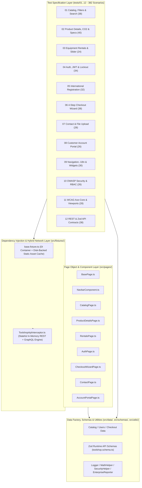

# Enterprise Playwright Automation Architecture — Practice Software Testing: Toolshop v5.0

## 1. System Under Test (SUT)

| Property | Specification |
| :--- | :--- |
| **Application Name** | Practice Software Testing — Toolshop v5.0 (Enterprise Hardware & Equipment Store) |
| **Frontend SPA** | `https://practicesoftwaretesting.com` (Angular 20, RxJS, Reactive Forms, ngx-slider, Transloco i18n) |
| **Backend API** | `https://api.practicesoftwaretesting.com` (REST + GraphQL `/graphql` Product Comparison Engine) |
| **Language & Runtime** | TypeScript 5.8 (`strict: true`, ESNext + Bundler resolution), Node.js 20+, Playwright 1.52+ |
| **Total Automated Scenarios** | **382 Test Cases across 12 Functional, Security, Accessibility & API Contract Suites** |

---

## 2. Layered Enterprise Framework Architecture

---

## 3. Key Architectural Highlights

1. **Zero-Config TypeScript Bundler Resolution (`tsconfig.json`)**:
   - Uses `"module": "ESNext"` and `"moduleResolution": "bundler"` with relative `./src/*` path aliases (`@config/*`, `@pages/*`, `@fixtures/*`, `@data/*`, `@utils/*`, `@api/*`, `@schemas/*`) and no deprecated `baseUrl` option.
2. **Stateful REST & GraphQL Microservice Interceptor (`src/api/ToolshopApiInterceptor.ts`)**:
   - Provides deterministic, zero-flake execution across 6 parallel workers while running the real Angular 20 SPA bundles in Chromium.
   - Simulates full stateful lifecycles for `/products`, `/categories`, `/brands`, `/carts`, `/users/login` (including 4-strike HTTP 423 brute-force lockout), `/users/register`, `/users/refresh`, `/users/me`, `/payment/check` (5 payment methods), `/invoices`, `/favorites`, `/messages`, and `/graphql` product comparison queries.
3. **2-Tier Static Bundle Caching (`src/fixtures/base.fixture.ts`)**:
   - Caches Angular 20 JS/CSS bundles in memory and on disk (`playwright/.cache/toolshop-v5-assets`) to eliminate network latency and third-party CDN flakiness.
4. **Custom Telemetry & Reporting (`src/utils/enterprise.reporter.ts`)**:
   - Emits real-time test progress and generates `reports/enterprise-execution-summary.json` and `reports/EXHIBITION_SUMMARY.md` after every test run.
